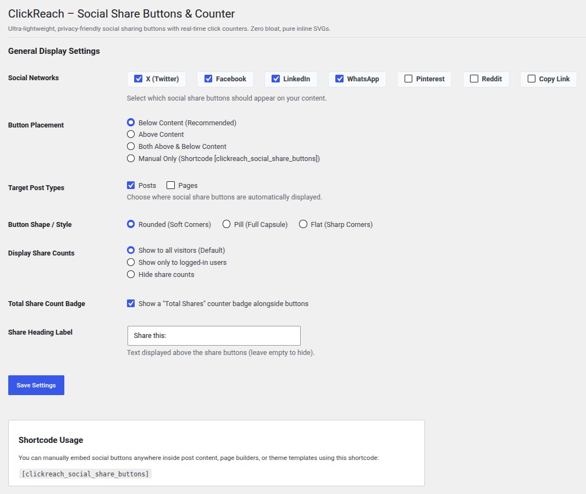

# ClickReach – Social Share Buttons & Counter

[](https://wordpress.org/plugins/clickreach-social-share-buttons/)
[](https://wordpress.org/plugins/clickreach-social-share-buttons/#reviews)
[](https://wordpress.org)
[](https://php.net)
[](https://www.gnu.org/licenses/gpl-2.0.html)
[](https://wordpress.org/plugins/plugin-check/)

Free, fast **social share buttons with share counts** for WordPress. **ClickReach** adds WhatsApp, Facebook, X (Twitter), LinkedIn, Pinterest, Reddit, and Copy Link share buttons to your posts, pages, and custom post types, with a live share counter, pure inline SVG icons, no cookies, and Core Web Vitals friendly performance.

**[Download ClickReach from WordPress.org →](https://wordpress.org/plugins/clickreach-social-share-buttons/)**

> **Development Repository**
>
> This GitHub repository is the development workspace for ClickReach – Social Share Buttons & Counter. For production sites, install the official release from the [WordPress.org plugin directory](https://wordpress.org/plugins/clickreach-social-share-buttons/).
>
> Releases are published to WordPress.org via SVN; this repository is used for version control, issue tracking, and future enhancements.

---

## Description

Unlike heavy commercial alternatives that load bloated libraries, external fonts, and third-party scripts, **ClickReach** is built from the ground up for speed, simplicity, and privacy. Share counts come from clicks on your own buttons, so there are no social network API keys, access tokens, or external count services to set up.

---

## Screenshot

<p align="center">
  
</p>

---

## Key Features

* **100% Free Forever:** No locked features, no "Pro" nag screens, and no subscription fees.
* **Ultra-Lightweight & Fast:** Pure embedded inline SVGs. Zero external HTTP requests, zero webfont downloads, no render-blocking styles, and no jQuery.
* **Live Click Counters:** Per-network counters and an optional total shares badge that update instantly via AJAX, without a page refresh.
* **Accurate, Abuse-Resistant Counts:** Each visitor is counted once per post and network per hour, with an hourly cap per visitor, so bots and scripts cannot inflate your numbers.
* **Works with Page Caching:** Click tracking works on cached pages (WP Rocket, LiteSpeed Cache, W3 Total Cache, WP Super Cache, and others).
* **Privacy-Friendly & GDPR Compliant:** No cookies, no browser storage, no tracking scripts. Visitors are identified only by a salted, short-lived hash of their IP address.
* **Supported Networks:** X (Twitter), Facebook, LinkedIn, WhatsApp, Pinterest, Reddit, and Copy Link.
* **Button Styles:** Rounded, Pill, or Flat.
* **Flexible Placement:** Above content, below content, both, or manually with a shortcode, for any public post type.
* **Per-Post Controls:** Enable or disable buttons on individual posts and pages from the editor.

---

## Installation

1. Clone or download the repository into your WordPress plugins directory:
   ```bash
   git clone https://github.com/abineshselvarasu/clickreach-social-share-buttons.git wp-content/plugins/clickreach-social-share-buttons
   ```
2. Activate **ClickReach – Social Share Buttons & Counter** in **WordPress Admin → Plugins**.
3. Go to **Settings → ClickReach Social Share Buttons** to choose networks, button style, and placement.

---

## Usage

### Automatic placement
Choose **Above Content**, **Below Content**, or **Both** in **Settings → ClickReach Social Share Buttons**, and select the post types where buttons should appear.

### Shortcode
Place the buttons anywhere (posts, pages, blocks, or page builders such as Elementor and Beaver Builder):

```
[clickreach_social_share_buttons]
```

### Per-post override
Use the **Social Share & Counter** box in the post editor to force buttons on or off for a single post or page.

---

## Developer Hooks

| Hook | Type | Description |
|---|---|---|
| `ssbc_after_click_tracked` | Action | Fires after a click is counted. Receives `$post_id`, `$platform`, `$new_count`, `$total`. |
| `ssbc_client_ip` | Filter | Override the visitor IP used for rate limiting, e.g. behind Cloudflare or a reverse proxy. |

Example for sites behind Cloudflare:

```php
add_filter( 'ssbc_client_ip', function ( $ip ) {
	return isset( $_SERVER['HTTP_CF_CONNECTING_IP'] )
		? sanitize_text_field( wp_unslash( $_SERVER['HTTP_CF_CONNECTING_IP'] ) )
		: $ip;
} );
```

Only use a header your proxy sets itself. Headers like `X-Forwarded-For` can be faked by visitors when no proxy is in front of your site.

---

## Release Process

`readme.txt` is the WordPress.org readme; this `README.md` is for GitHub only. Files listed in `.distignore` (including this file) are excluded from the WordPress.org package.

---

## License

ClickReach – Social Share Buttons & Counter is open-source software licensed under the [GPL-2.0-or-later](https://www.gnu.org/licenses/gpl-2.0.html).

---

## Author

Built by [Abinesh Selvarasu](https://profiles.wordpress.org/abineshselvarasu/). Found a bug or have an idea? [Open an issue](https://github.com/abineshselvarasu/clickreach-social-share-buttons/issues) or ask on the [WordPress.org support forum](https://wordpress.org/support/plugin/clickreach-social-share-buttons/).
